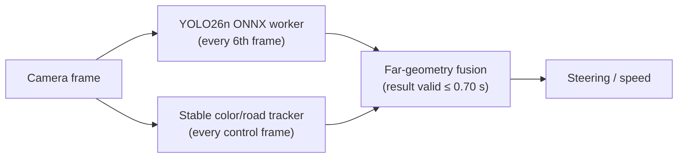

# AMET 2026 — 주황 중앙선 검출 모델 실험 (YOLO26n)

2026 AMET 자율주행 해커톤에서 주황 중앙선을 더 먼 거리에서 인식할 수 있을지 확인하기 위해 진행한 개인 브랜치 실험입니다. 트랙 이미지 라벨링, YOLO26n 학습, ONNX 변환과 Raspberry Pi 5 실차 측정까지 진행했습니다.

차량 CPU의 추론 지연은 세 런에서 p50 **318.5 / 373.0 / 376.4 ms**였습니다. 주행 제어에 사용하기에는 느려 **팀의 최종 레이스 빌드에는 포함하지 않았습니다**. 팀은 별도 카메라·LiDAR 주행 스택으로 본선 3위와 우수상(현대모비스상)을 받았습니다. 팀 주행 코드와 개인 실험 코드는 분리했습니다.

| 항목 | 내용 |
|---|---|
| 질문 | 직접 학습한 소형 검출기가 기존 색 기반 트래커보다 먼 코너의 경로 기하를 먼저 줄 수 있는가 |
| 내가 한 일 | 라벨링 → Roboflow 버전 관리 → Colab 학습 → ONNX 배포 → CPU 런타임·타이밍 계측 → 실차 시험 |
| 모델 | YOLO26n detect, 단일 클래스 `center`, 640 px |
| 실차 지연 | 추론 p50 **318.5 / 373.0 / 376.4 ms** (런 3개, YOLO 결과 단위) |
| 판단 | 제어 루프 예산 초과가 프레임의 76–99%, 완주 0/3 → **레이스 미채택** |
| 근거 | 실차 텔레메트리 3개 + 재계산 스크립트 ([`realcar_runs/`](realcar_runs)) |

## 시스템과 범위



이 구조는 제 개인 브랜치의 후보 설계입니다. 매 프레임 근거리 제어는 기존 트래커가 맡고, YOLO는 6프레임마다 별도 worker에서 돌아 먼 구간의 경로 기하만 보태도록 했습니다(설정값은 각 런의 [`run_meta.json`](realcar_runs/e37cdca_20260826_0028/run_meta.json)).

## 데이터와 학습

- 주황 점선 중앙선 조각마다 `center` 박스 하나 ([`LABELING.md`](LABELING.md)).
- v1: 밝은 조건 원본 약 231장 → Roboflow export 575장(증강 포함). v2: 밝음+어두움 원본 546장 → export 1,364장(train 1,228 / valid 82 / test 54).
- [`training/`](training)은 v1 학습 결과입니다(마지막 epoch val P 0.785 / R 0.683 / mAP50 0.673).
- 실차에 올린 모델은 v2 계열 `old_v2`: 54장 held-out test에서 **P 0.836 / R 0.787 / mAP50 0.846 / mAP50-95 0.661** ([`TRAINING.md`](TRAINING.md)).

## 런타임

[`runtime/orange_yolo.py`](runtime/orange_yolo.py)는 ONNX 출력 계약(`1×3×640×640` → `1×300×6`, end-to-end NMS 행)을 실행 중에 검사하고, 전처리·추론·후처리 시간을 결과마다 기록합니다. ONNX Runtime(CPU)을 먼저 쓰고 실패하면 OpenCV DNN으로 넘어가며, 로드·추론 오류 시에는 기존 트래커가 계속 제어합니다.

## 측정

### 실차 (Raspberry Pi 5 CPU, ONNX Runtime 1.29.0, 2 threads)

| 런 (commit_시각) | YOLO 결과 수 | 추론 p50 | p95 | max | 제어 루프 overrun | 종료 |
|---|---:|---:|---:|---:|---:|---|
| `fb45865_20260825_2306` | 55 | 318.5 ms | 399.7 ms | 450.7 ms | 153 / 155 | 런타임 예외(차량 제어 API 통신 오류) |
| `74b3bf1_20260826_0004` | 68 | 373.0 ms | 459.1 ms | 540.5 ms | 313 / 409 | 수동 정지 |
| `e37cdca_20260826_0028` | 69 | 376.4 ms | 450.1 ms | 533.6 ms | 326 / 414 | 수동 정지 |

- 텔레메트리는 제어 프레임마다 직전 YOLO 결과를 반복 기록하므로, 지연은 `yolo_result_frame`으로 중복을 지우고 결과 1회당 한 번씩 셌습니다. 제어 프레임 단위로 세면 `e37cdca`의 p50은 373.7 ms입니다.
- 이전에 적었던 “p50 318 ms / p95 400 ms”는 첫 런(`fb45865`) 값이고, “약 374 ms”는 이후 두 런의 값입니다. 둘 다 실측이지만 다른 런입니다.

재현:

```bash
cd realcar_runs
python summarize_runs.py     # run_summary.csv 생성, 표준 라이브러리만 사용
```

### 오프라인 (참고, 차량 아님)

| 환경 | 조건 | 총 시간 p50 | p95 |
|---|---|---:|---:|
| Windows, OpenCV 5 | 실차 녹화 596프레임 재생 | 52.09 ms | 62.46 ms |
| 평가용 Docker, ONNX Runtime 1.29.0 | 시뮬레이터 부하 중 warm 30회 | 104.81 ms | 173.18 ms |

같은 596프레임 녹화에서 YOLO 기반 경로 기하가 유효한 프레임은 289개(48.5%), 기존 트래커는 205개(34.4%)였습니다. 이것은 오프라인 진단 결과이며 실차 주행 성능을 뜻하지 않습니다([`docs/feature_branch_report_20260826.md`](docs/feature_branch_report_20260826.md)).

## 레이스 빌드에 넣지 않은 이유

- 데스크톱에서 50 ms 수준이던 추론이 차량 CPU에서는 300 ms를 넘었습니다. 오프라인에서 보인 경로 기하 이득은 차량에서 쓸 수 있는 시간 안에 오지 않았습니다.
- YOLO를 켠 세 런에서 제어 루프가 예산을 넘긴 프레임이 76–99%였고, 완주한 런이 없었습니다.
- 그래서 후보를 팀 main에 합치지 않았고, 레이스 빌드에는 들어가지 않았습니다.

## 한계

- 실차 런은 3개뿐이며, 같은 commit으로 YOLO를 끈 실차 대조 런은 없습니다. 따라서 overrun 원인을 YOLO 하나로 분리하지 못했습니다.
- 런마다 commit과 조건이 다릅니다(`74b3bf1`은 손으로 든 카메라와 장착 카메라를 비교한 런).
- 모델 정확도(P/R/mAP)는 54장 test 기준입니다. 원본 이미지, 가중치, v2 학습 곡선은 싣지 않았습니다.
- 팀 주행 스택, 대회 제공 시뮬레이터·예제, 팀원 코드는 포함하지 않습니다.

## 구성

```text
.
├─ README.md
├─ LABELING.md · TRAINING.md
├─ dataset/          # Roboflow v1 export 메타데이터 (이미지 없음)
├─ training/         # v1 학습 결과 (args.yaml, results.csv, 곡선)
├─ runtime/          # orange_yolo.py — ONNX CPU 런타임, 결과별 타이밍
├─ realcar_runs/     # 실차 3개 런의 telemetry.csv, run_meta.json, summarize_runs.py
└─ docs/             # 2026-08-26 개인 브랜치 작업 보고서 (원문 유지, 머리말 추가)
```

## 정정 이력

2026-10-22에 다른 저장소(`orange_lane_yolo/`)로 처음 공개한 버전은 “최종 빌드에서 색 기반 트래커를 주 제어로, YOLO를 먼 거리 보조로 썼다”고 적었습니다. 이는 사실이 아닙니다. 이 후보는 레이스에 쓰이지 않았고, 팀의 최종 스택도 색 기반 트래커가 아니었습니다. 또 데이터셋을 575장 하나로만 적어 v1/v2 계보를 빠뜨렸습니다. 이 저장소에서 바로잡았습니다.

License: 선정하지 않음(All rights reserved).

---

## English summary

A personal experiment from the 2026 AMET hackathon (Raspberry Pi 5, ROS 2, team of five). I labeled real-track images (one `center` box per orange divider dash), versioned them in Roboflow (v1: ~231 source images, 575 exported; v2: 546 source images, 1,364 exported), fine-tuned YOLO26n in Colab (selected `old_v2`: P 0.836 / R 0.787 / mAP50 0.846 on a 54-image held-out test), and deployed it as an ONNX CPU worker feeding far-range path geometry. On the vehicle CPU, per-result inference took **318.5, 373.0 and 376.4 ms (p50)** in three runs; the control loop overran its budget in 76–99% of frames and no run completed a lap. The candidate was **not merged into the team's main branch and was not used in the race**; the team's result (4th in prelims, 3rd in finals, Hyundai Mobis Excellence Award) came from a separate team-built camera + LiDAR stack that is not in this repository. Telemetry for all three runs and a stdlib script that recomputes the table are in [`realcar_runs/`](realcar_runs). Limitation: no same-commit YOLO-off real-car control run, so overruns are not attributed to YOLO alone.
